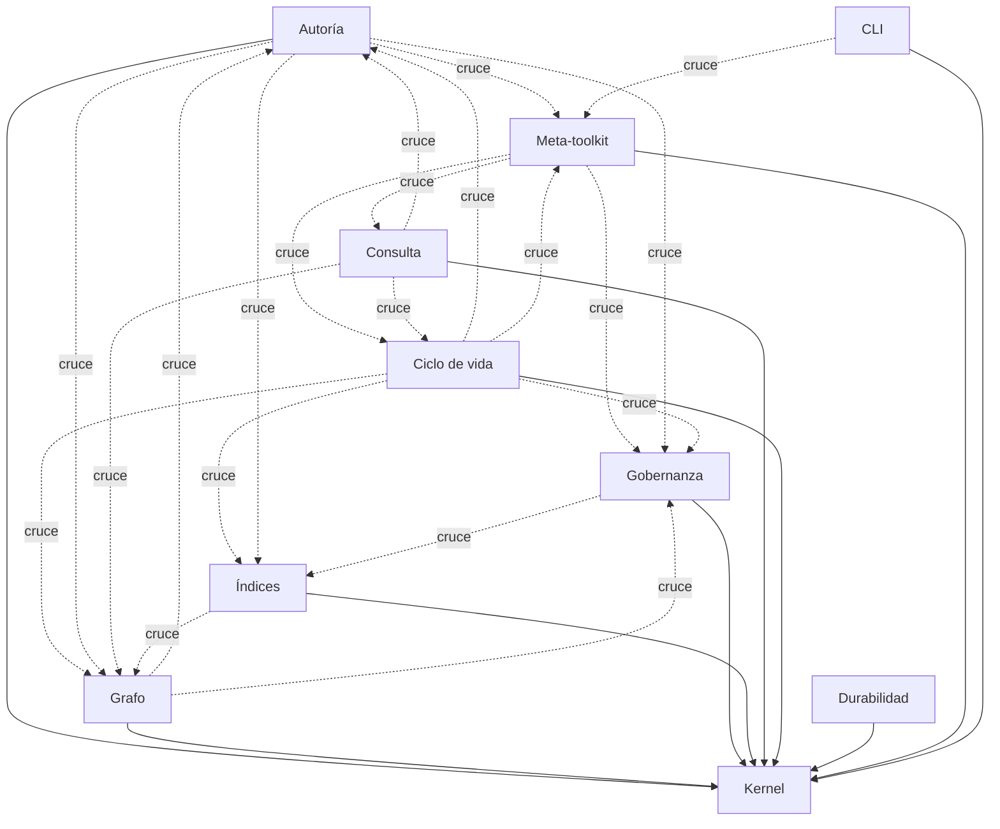

# Arquitectura del estándar — contextos acotados

> Documento derivado. Se genera con `python scripts/vault_arch.py --blueprint`; la fuente es `CONTEXTS` en `scripts/vault_arch.py`. No se edita a mano.

**10 contextos**, **179 módulos** clasificados, **32 fronteras cruzadas** pendientes de publicar puerto.

## Los límites

1. Kernel ← todos. Nadie más puede ser dependencia de todos.
2. Contexto ↛ contexto. Se consume el puerto publicado, no el módulo ajeno.
3. Meta-toolkit ↛ vault. No importa nada que escriba en un vault.
4. Adaptadores ↛ dominio ajeno. `scripts/`, `cli/` y el `.mjs` traducen transporte; no deciden.
5. Raíz de composición: `vault/kernel/adaptadores.py` es el único fichero que puede cruzar a cualquier contexto, porque su trabajo es cablearlos.

## Mapa de contextos

## Kernel

- **Lenguaje ubicuo:** ruta, envelope, error, bloqueo, escritura atómica
- **Puertos publicados:** `atomic_write_text` → `vault_io:atomic_write_text`, `file_lock` → `vault_fs:file_lock`, `get_vault_root` → `vault_raiz:get_vault_root`, `wrap_main` → `vault_errors:wrap_main`
- **No cruza:** depender de cualquier contexto de dominio
- **Módulos (24):** `vault_audit_catalog`, `vault_baseline`, `vault_contrato_nota`, `vault_encoding`, `vault_entorno`, `vault_errors`, `vault_errors_catalog`, `vault_errors_trace`, `vault_escaneo_grafo`, `vault_fs`, `vault_fundamentals_catalog`, `vault_grafo_import`, `vault_io`, `vault_ledger`, `vault_lib`, `vault_mermaid_reglas`, `vault_norms_catalog`, `vault_raiz`, `vault_regex`, `vault_registry`, `vault_subproceso`, `vault_vcs`, `vault_version`, `vault_vocabulario`

## Autoría

- **Lenguaje ubicuo:** nota, frontmatter, slug, sección, alias
- **Puertos publicados:** `anexar` → `vault_append:vault_append`, `buscar` → `vault_search:vault_search`, `escribir_nota` → `vault_write:vault_write`, `fusionar` → `vault_merge:vault_merge`, `hablar` → `vault/autoria/voz:speak`, `mover` → `vault_move:move_note`, `tipo_por_carpeta` → `vault_write:tipo_por_carpeta`
- **Módulos (47):** `vault_ai_decision`, `vault_append`, `vault_bibliography_save`, `vault_bug_save`, `vault_change_log`, `vault_dataset`, `vault_delete`, `vault_delta`, `vault_diagram_export`, `vault_diagram_save`, `vault_diff`, `vault_env_save`, `vault_fix_brackets`, `vault_flow_save`, `vault_frontmatter_completar`, `vault_frontmatter_heal`, `vault_incident_save`, `vault_infra_save`, `vault_knowledge_get`, `vault_knowledge_save`, `vault_list`, `vault_log_error`, `vault_merge`, `vault_move`, `vault_ncr_save`, `vault_pattern_list`, `vault_pattern_save`, `vault_privacy_save`, `vault_project`, `vault_project_overview`, `vault_project_status`, `vault_qa_save`, `vault_read`, `vault_release_save`, `vault_requirement_save`, `vault_risk_save`, `vault_ronda`, `vault_runbook_log`, `vault_runbook_save`, `vault_search`, `vault_slo_save`, `vault_supersede`, `vault_test_save`, `vault_timeline`, `vault_undo`, `vault_voice`, `vault_write`

Fronteras que hoy cruza (5), deuda declarada:

| Módulo | Importa | Contexto destino |
|---|---|---|
| `vault_change_log` | `vault/gobernanza` | Gobernanza |
| `vault_voice` | `vault_mcp_catalog` | Meta-toolkit |
| `vault_write` | `vault_tags` | Índices |
| `vault/autoria/repositorio.py` | `vault/indices` (4 imports) | Índices |
| `vault/autoria/repositorio.py` | `vault/grafo` (4 imports) | Grafo |

## Grafo

- **Lenguaje ubicuo:** nodo, arista, wikilink, huérfano, componente
- **Puertos publicados:** `construir_grafo` → `vault_graph:vault_graph`, `impacto` → `vault_impact:vault_impact`, `refresco_de_grafo` → `vault_graph:refrescar_nota_en_grafo`, `resolver_wikilink` → `vault_link_safety:validate_wikilinks`
- **Módulos (15):** `vault_code_map`, `vault_code_module`, `vault_code_query`, `vault_code_relation`, `vault_code_sync`, `vault_code_tag`, `vault_env_matrix`, `vault_graph`, `vault_graph_fix`, `vault_graph_inspect`, `vault_graph_merge`, `vault_impact`, `vault_infra_map`, `vault_link_safety`, `vault_relation_add`

Fronteras que hoy cruza (2), deuda declarada:

| Módulo | Importa | Contexto destino |
|---|---|---|
| `vault_code_tag` | `vault_write` | Autoría |
| `vault/grafo/repositorio.py` | `vault/gobernanza` | Gobernanza |

## Gobernanza

- **Lenguaje ubicuo:** norma, guard, enforcement, severidad, violación, estado, transición de estado, fundamento, hallazgo
- **Puertos publicados:** `FUNDAMENTOS` → `vault_fundamentals:FUNDAMENTALS`, `NORM_CATALOG` → `vault_norms:NORM_CATALOG`, `auditar` → `vault_audit:vault_audit`, `auditar_normas` → `vault_norms:vault_norms_audit`, `auditar_runtime` → `vault/gobernanza/auditoria_runtime:auditar_runtime`, `cuerpo_sin_marcadores` → `vault_norms:cuerpo_sin_marcadores`, `gancho_de_secretos` → `vault/gobernanza/secret_scan:vault_write_hook`, `hay_hallazgos_bloqueantes` → `vault/gobernanza/secret_scan:has_blocking_findings`, `identidad_de_documentacion` → `vault_audit:es_documentacion_del_estandar`, `lineas_de_estado` → `vault_norms:status_frontmatter_lines`, `norma_por_codigo` → `vault_norms:norma_por_codigo`, `normalizar_estado` → `vault_norms:normalize_status`, `penalizaciones` → `vault_audit:PENALIZACIONES`, `puntuar_calidad` → `vault_quality_check:vault_quality_check`, `referencias_de_norma` → `vault_norms:compute_norm_refs`, `registro_de_ciclo_de_vida` → `vault_norms:LIFECYCLE_REGISTRY`, `transiciones_de_estado` → `vault_norms:STATUS_TRANSITIONS`, `validar_mermaid` → `vault_mermaid_check:validate_mermaid`, `valores_cia` → `vault_fundamentals:cia_valores`, `vocabulario_de_dominio` → `vault_norms:DOMAIN_STATUS_VOCABS`, `vocabulario_de_estado` → `vault_norms:STATUS_VOCAB`
- **Módulos (13):** `vault_audit`, `vault_drift_detect`, `vault_fuente_unica`, `vault_fundamentals`, `vault_mermaid_check`, `vault_norms`, `vault_norms_engine`, `vault_quality_check`, `vault_quality_dashboard`, `vault_secret_scan`, `vault_security_rules`, `vault_security_scan`, `vault_validate`

Fronteras que hoy cruza (2), deuda declarada:

| Módulo | Importa | Contexto destino |
|---|---|---|
| `vault/gobernanza/auditoria_runtime.py` | `vault/indices` (4 imports) | Índices |
| `vault/gobernanza/repositorio.py` | `vault/indices` | Índices |

## Índices

- **Lenguaje ubicuo:** índice, etiqueta, término, sección indexada, coherencia
- **Puertos publicados:** `coherencia_de_indices` → `vault_reindex:index_coherence`, `enumeracion_indexable` → `vault_reindex:notas_indexables`, `indice_de_seccion` → `vault_section_index:vault_section_index`, `indice_maestro` → `vault_master_index:vault_master_index`, `ledger_de_backfill_de_tags` → `vault_tags:vault_tags_backfill_ledger`, `refresco_de_busqueda` → `vault_section_index:refrescar_busqueda`, `registrar_tags` → `vault_tags:registrar_tags_de_nota`, `registro_de_nuevos_terminos` → `vault_tags:record_new_tags`, `reindexar` → `vault_reindex:vault_reindex`, `resolucion_de_vocabulario` → `vault_tags:apply_vocabulary`, `tags_de_frontmatter` → `vault_tags:tags_de_frontmatter`, `vocabulario_de_tags` → `vault_tags:canonical_tags`
- **Módulos (7):** `vault_folder_registry`, `vault_index`, `vault_master_index`, `vault_reindex`, `vault_section`, `vault_section_index`, `vault_tags`

Fronteras que hoy cruza (1), deuda declarada:

| Módulo | Importa | Contexto destino |
|---|---|---|
| `vault/indices/repositorio.py` | `vault/grafo` | Grafo |

## Consulta

- **Lenguaje ubicuo:** intención, subgrafo, paquete de contexto, preferencia
- **Puertos publicados:** `cargar_contexto` → `vault_mcp_context:load_context`, `contexto_de_sesion` → `vault_mcp_context:get_context`, `empaquetar_contexto` → `vault_context_pack:vault_context_pack`, `guardar_contexto` → `vault_mcp_context:save_context`, `limpiar_contexto` → `vault_mcp_context:clear_context`, `parsear_consulta` → `vault_query_parse:vault_query_parse`, `subgrafo` → `vault_subgraph:vault_subgraph`
- **No cruza:** base de datos; embeddings; servicio externo
- **Módulos (11):** `vault_compact_contracts`, `vault_context_pack`, `vault_ingest`, `vault_mcp_context`, `vault_model_profile`, `vault_preferences`, `vault_query_parse`, `vault_subgraph`, `vault_token_counter`, `vault_token_service`, `vault_tokens`

Fronteras que hoy cruza (3), deuda declarada:

| Módulo | Importa | Contexto destino |
|---|---|---|
| `vault_context_pack` | `vault_search` | Autoría |
| `vault/consulta/repositorio.py` | `vault/ciclo_de_vida` | Ciclo de vida |
| `vault_subgraph` | `vault/grafo` (3 imports) | Grafo |

## Ciclo de vida

- **Lenguaje ubicuo:** versión, migración, sanación, arranque
- **Puertos publicados:** `CURRENT_VERSION` → `vault_standard_upgrade:CURRENT_VERSION`, `inicializar` → `vault_init:vault_init`, `migrar` → `vault_standard_upgrade:vault_standard_upgrade`
- **Módulos (10):** `vault_arquitectura_en`, `vault_history_compact`, `vault_init`, `vault_migrate_docs`, `vault_migrate_rollback`, `vault_onboard`, `vault_propagate`, `vault_sanacion`, `vault_sdd_init`, `vault_standard_upgrade`

Fronteras que hoy cruza (12), deuda declarada:

| Módulo | Importa | Contexto destino |
|---|---|---|
| `vault_onboard` | `vault_reindex` | Índices |
| `vault_onboard` | `vault_section_index` | Índices |
| `vault_onboard` | `vault_tags` | Índices |
| `vault_onboard` | `vault_write` | Autoría |
| `vault_propagate` | `vault_impact` | Grafo |
| `vault_propagate` | `vault/gobernanza` | Gobernanza |
| `vault_standard_upgrade` | `vault_mcp_catalog` | Meta-toolkit |
| `vault_standard_upgrade` | `vault_section_index` | Índices |
| `vault/ciclo_de_vida/repositorio.py` | `vault/indices` (2 imports) | Índices |
| `vault_sanacion` | `vault_audit` | Gobernanza |
| `vault_sanacion` | `vault_reindex` | Índices |
| `vault_sanacion` | `vault/gobernanza` | Gobernanza |

## Durabilidad

- **Lenguaje ubicuo:** backup, restauración, cuarentena, manifiesto
- **Puertos publicados:** `crear_backup` → `vault_backup:vault_backup`, `listar_backups` → `vault_backup_list:vault_backup_list`, `poner_en_cuarentena` → `vault_quarantine:vault_quarantine_add`, `restaurar` → `vault_restore:vault_restore`
- **No cruza:** escribir fuera de la raíz del vault (AP-36)
- **Módulos (4):** `vault_backup`, `vault_backup_list`, `vault_quarantine`, `vault_restore`

## Meta-toolkit

- **Lenguaje ubicuo:** catálogo, contrato, spec, smoke, conteo derivado
- **Puertos publicados:** `GROUPS` → `vault_mcp_catalog:GROUPS`, `NATIVE_JS_TOOLS` → `vault_mcp_catalog:NATIVE_JS_TOOLS`, `TOOLS_CATALOG` → `vault_mcp_catalog:TOOLS_CATALOG`, `check_contracts` → `vault_mcp_catalog:check_contracts`, `distribution_metadata` → `vault_mcp_catalog:distribution_metadata`, `reconciled_params` → `vault_mcp_catalog:reconciled_params`
- **No cruza:** escribir en una sección de contenido: sus artefactos derivados viven en 00_System/
- **Módulos (40):** `vault_arch`, `vault_blame_audit`, `vault_blueprint`, `vault_changelog_check`, `vault_ciclos`, `vault_clones`, `vault_criterios`, `vault_distribution_sync`, `vault_doc_counts`, `vault_doc_staleness`, `vault_doc_sync`, `vault_error_contract`, `vault_esquema`, `vault_excepcion_declarada`, `vault_firma_sitio`, `vault_fix_all`, `vault_foreign_check`, `vault_gate`, `vault_kernel`, `vault_manifest`, `vault_mcp`, `vault_mcp_catalog`, `vault_metricas`, `vault_noop_audit`, `vault_norms_coherence`, `vault_procesos_git`, `vault_produccion`, `vault_recursos`, `vault_release`, `vault_servicio`, `vault_smoke`, `vault_spec_catalog_check`, `vault_spec_data`, `vault_spec_generate_catalog`, `vault_spec_memory`, `vault_spec_validate`, `vault_test_runner`, `vault_test_scope`, `vault_tests_higiene`, `vault_toolkit_audit`

Fronteras que hoy cruza (6), deuda declarada:

| Módulo | Importa | Contexto destino |
|---|---|---|
| `vault_blueprint` | `vault_norms` | Gobernanza |
| `vault_norms_coherence` | `vault_norms` | Gobernanza |
| `vault_spec_memory` | `vault/ciclo_de_vida` | Ciclo de vida |
| `vault_spec_memory` | `vault/gobernanza` | Gobernanza |
| `vault/meta_toolkit/catalog_adapter.py` | `vault/gobernanza` | Gobernanza |
| `vault_mcp` | `vault_mcp_context` | Consulta |

## CLI

- **Lenguaje ubicuo:** comando, registro de tools, preflight, envelope
- **Puertos publicados:**
- **No cruza:** decidir: traduce argumentos a llamadas y envelopes a salida; la decisión vive en la tool
- **Módulos (8):** `__main__`, `analyzer`, `registry`, `resolver`, `runner`, `safety`, `scheduler`, `vault_cli`

Fronteras que hoy cruza (1), deuda declarada:

| Módulo | Importa | Contexto destino |
|---|---|---|
| `cli/registry` | `vault_mcp_catalog` | Meta-toolkit |

## Rutas de escritura

Quién escribe qué. Derivado del catálogo (`side_effects`): es el inventario que la política de inmutabilidad necesita —una sección que se declare inmutable tiene que saber quién la escribe—.
- `vault_ai_decision` (IA Governance): Crea nota en 16_AI_Governance/decisions/
- `vault_append` (Core): Añade contenido a la nota existente y refresca su updatedAt; Anota el cambio en el change-log (F8, no repudio)
- `vault_arch` (Normas): Con --freeze reescribe scripts/arch-baseline.json; Con --blueprint reescribe docs/ARQUITECTURA.md
- `vault_backup` (Backups): Crea carpeta en vault-backups/
- `vault_backup_base64` (Backups): Genera archivo .b64zip.json en vault-backups/
- `vault_bibliography_save` (Bibliografía): Crea nota en 12_Bibliography/{project}-{slug}.md
- `vault_blame_audit` (Normas): Con --freeze reescribe scripts/blame-baseline.json
- `vault_blueprint` (Normas): docs/BLUEPRINT.md; scripts/blueprint-baseline.json
- `vault_bug_save` (Defectos y Cuarentena): Crea nota en 18_Bugs/{open|root-causes|fixed}/; Actualiza 18_Bugs/.bugs-index.json
- `vault_change_log` (Change Log): Registra el cambio en el changelog del vault (con --propagate encola la propagación)
- `vault_changelog_check` (Normas): Con --fijar-hash reescribe la entrada de la versión en curso; Con --freeze escribe scripts/changelog-baseline.json
- `vault_ciclos` (Normas): scripts/ciclos-baseline.json
- `vault_clones` (Normas): scripts\clones-baseline.json
- `vault_code_map` (Código): Genera 11_Code/{project}/map.md con diagrama
- `vault_code_module` (Código): Crea nota en 11_Code/{project}/
- `vault_code_relation` (Código): Actualiza índice de relaciones en 11_Code/
- `vault_code_sync` (Código): Actualiza 11_Code/{project}/index.json; Con --fix: inyecta @vault: en los ficheros fuente del proyecto, FUERA del vault (AP-36: el side effect se declara para poder revisarlo)
- `vault_code_tag` (Normas): Actualiza frontmatter del módulo
- `vault_criterios` (Normas): scripts/criterios-baseline.json
- `vault_delete` (Change Log): Escribe entrada en 00_System/.change-log.json; Escribe entrada en 00_System/change-log.md; Elimina o mueve a 20_Quarantine/; Guarda la versión borrada en .history/ (la restaura vault_undo --restore)
- `vault_delta` (Session Delta y Tags): Crea 00_System/delta-snapshot.json
- `vault_diagram_export` (Diagramas): Genera archivos exportados
- `vault_diagram_save` (Diagramas): Crea nota en 06_Diagrams/{category}/
- `vault_doc_counts` (Normas): Con --fix reescribe cifras en los documentos vigilados
- `vault_doc_sync` (Normas): Con --fix reescribe la tabla de índice de scripts/README.md
- `vault_drift_detect` (Drift Detection): --mode snapshot escribe el snapshot de sesión en 00_System/ y, sobre git, repo.synced_commit en la ficha del proyecto
- `vault_env_matrix` (Infraestructura): Genera 09_Infrastructure/{project}/matrix.md
- `vault_env_save` (Infraestructura): Crea nota en 09_Infrastructure/{project}/
- `vault_error_contract` (Normas): scripts/error-contract-baseline.json (solo con --freeze)
- `vault_esquema` (Normas): schemas/
- `vault_excepcion_declarada` (Normas): scripts/excepcion-declarada-baseline.json
- `vault_fix_all` (Normas): Regenera tools-catalog.json, env-table.json, field-compat-baseline.json, docs/ARQUITECTURA.md, docs/BLUEPRINT.md y las cifras del README
- `vault_fix_brackets` (Corrección Automática): Backups en vault-backups/.vault-fix-backup-YYYYMMDD-HHMMSS/
- `vault_flow_save` (Flujos): Crea nota en 13_Flows/{type}/
- `vault_folder_registry` (Gestión de Carpetas): Crea/actualiza 00_System/custom-folders.json
- `vault_frontmatter_completar` (Corrección Automática): Reescribe el frontmatter de la nota por atomic_write_text
- `vault_frontmatter_heal` (Corrección Automática): Reescribe la nota reparada por atomic_write_text
- `vault_fuente_unica` (Salud del Vault): scripts/fuente-unica-baseline.json
- `vault_fundamentals` (Data Quality): Con --framework/--doc escribe el marco de datos y la documentación derivada (en el checkout del estándar)
- `vault_graph` (Salud del Vault): Crea 99_Index/graph.json
- `vault_graph_fix` (Corrección Automática): Modifica wikilinks en notas; Crea stubs si es necesario
- `vault_graph_merge` (Salud del Vault): Genera 99_Index/graph-enriched.json; Detecta AP-31 (untyped graph), AP-34 (orphan typed relations), AP-35 (relationship silos)
- `vault_history_compact` (Versionado): Borra archivos de .history/
- `vault_incident_save` (Producción/SRE): Crea nota en 02_Observability/incidents/
- `vault_infra_map` (Infraestructura): Genera diagrama en 09_Infrastructure/{project}/
- `vault_infra_save` (Infraestructura): Crea nota en 09_Infrastructure/{project}/
- `vault_ingest` (Memoria de Contexto): Con --commit: crea notas en la sección destino con status draft; Actualiza el índice de la sección
- `vault_init` (Bootstrap): Crea carpetas, versiona, indexa, audit; Con --name: crea el vault en la casa y le hace su repositorio git
- `vault_kernel` (Normas): scripts/kernel-baseline.json
- `vault_knowledge_save` (Conocimiento): Crea nota en 07_Knowledge/{topic}/
- `vault_log_error` (Observabilidad): Crea/actualiza nota en 02_Observability/
- `vault_master_index` (Índices): Genera 99_Index/index.md
- `vault_merge` (Core): Crea backups antes de modificar
- `vault_mermaid_check` (Diagramas): Con --fix (sin --dry-run): reescribe los .md cuyo bloque el compilador señala, SOLO si una propuesta es aprobada por el compilador; escritura por el patrón canónico (file_lock + record_raw_write + escritura_atomica + refrescar_grafo)
- `vault_metricas` (Normas): scripts/metricas-observaciones.json; docs/METRICAS.md
- `vault_migrate_docs` (Migración): Copia/move archivos
- `vault_migrate_rollback` (Migración): Revierte archivos migrados
- `vault_model_profile` (Memoria de Contexto): Actualiza 17_Preferences/model_profile.active
- `vault_move` (Core): Actualiza wiki-links, search-index, graph.json, move-log
- `vault_ncr_save` (Riesgos/Calidad): Crea nota en 02_Observability/ncr/
- `vault_noop_audit` (Normas): Con --freeze reescribe scripts/noop-baseline.json
- `vault_norms` (Normas): Con --apply/--apply-heal edita las notas de norma del vault; Con --rebuild/--audit escribe el registro de normas y sus artefactos derivados
- `vault_norms_coherence` (Normas): scripts/norms-coherence-baseline.json
- `vault_onboard` (Bootstrap): Crea notas en las secciones 01…17 del vault destino; No modifica el proyecto de origen: solo lo lee
- `vault_pattern_save` (Patrones): Crea nota en 05_Patterns/
- `vault_preferences` (Memoria de Contexto): Crea/actualiza nota en 17_Preferences/{category}/; Actualiza índice de 17_Preferences
- `vault_privacy_save` (Riesgos/Calidad): Crea nota en 02_Observability/privacy/
- `vault_produccion` (Normas): docs/GUIA-DE-PRODUCCION.md
- `vault_project` (Vista del Proyecto): Crea 01_Projects/<slug>/project.md (add); Escribe 00_System/.local/project-paths.json y su .gitignore (link); Escribe 00_System/project-registry.json (rebuild)
- `vault_project_overview` (Vista del Proyecto): Crea/actualiza 01_Projects/{slug}/overview.md
- `vault_project_status` (Vista del Proyecto): Con --status/--summary escribe el status del proyecto y anota la entrada en su changelog
- `vault_propagate` (Propagación): Actualiza notas relacionadas
- `vault_qa_save` (Tests): Crea 21_QA/.qa-index.json si no existe
- `vault_quality_check` (Data Quality): Genera reporte en 00_System/
- `vault_quality_dashboard` (Tests): Genera 02_Observability/qa/quality-dashboard.md
- `vault_quarantine` (Defectos y Cuarentena): Mueve la nota a 20_Quarantine/{category}/; Actualiza 20_Quarantine/.quarantine-ledger.json (append-only)
- `vault_recursos` (Normas): scripts/recursos-baseline.json
- `vault_reindex` (Índices): Actualiza 99_Index/search-index.json; Opcional: 99_Index/graph.json, hash-index.json
- `vault_relation_add` (Diagramas): Actualiza relaciones en 07_Knowledge/
- `vault_release_save` (Release): Crea nota en 01_Projects/{project}/releases/
- `vault_requirement_save` (Requerimientos): Crea nota en 01_Projects/{project}/requirements/
- `vault_restore` (Backups): Sobreescribe archivos del vault
- `vault_restore_base64` (Backups): Restaura vault a nuevo directorio
- `vault_risk_save` (Riesgos/Calidad): Crea nota en 01_Projects/{project}/risks/
- `vault_ronda` (Session Delta y Tags): Escribe y borra 00_System/ronda-activa.json; Al cerrar, escribe la nota de sesion en 04_Sessions/ por vault_write
- `vault_runbook_log` (Runbooks): Actualiza log del runbook
- `vault_runbook_save` (Runbooks): Crea nota en 08_Runbooks/{project}/
- `vault_sdd_init` (Skills): Escribe 13 documentos derivados en docs/sdd/; Escribe docs/sdd/gaps.md solo si no existe o no tiene contenido manual
- `vault_section` (Gestión de Carpetas): Crea/actualiza 00_System/secciones.json; Crea la carpeta de la sección si no existe
- `vault_section_index` (Índices): Genera {section}/index.md
- `vault_security_scan` (Seguridad): Genera reporte en 02_Observability/vulnerabilities/
- `vault_slo_save` (Producción/SRE): Crea nota en 02_Observability/slos/
- `vault_smoke` (Normas): scripts/smoke-baseline.json
- `vault_standard_upgrade` (Versionado): Actualiza 00_System/standard-version.json; Ejecuta fixes automáticos
- `vault_supersede` (Corrección Automática): Reescribe el frontmatter de la nota por atomic_write_text; el cuerpo no cambia
- `vault_tags` (Session Delta y Tags): Reconstruye 00_System/tag-registry.json y 99_Index/tag-index.md; Anota términos nuevos en 19_Audits/vocabulary/tag-ledger.json (append-only)
- `vault_test_save` (Tests): Crea nota en 15_Tests/{test_type}/{project}-{slug}.md
- `vault_tests_higiene` (Normas): scripts/tests-higiene-baseline.json
- `vault_token_service` (Tokens): Sirve la API HTTP local y escribe los flujos de tokens y los ficheros de estado del servicio
- `vault_toolkit_audit` (Normas): scripts/toolkit-audit-baseline.json; scripts/toolkit-audit-last.json; scripts/toolkit-audit-last-parcial.json
- `vault_undo` (Versionado): SP-01: escribe change_log si --force; Crea nota restaurada o sobreescribe la actual
- `vault_voice` (Normas): 00_System/.voice-counter
- `vault_write` (Core): Versiona en .history/; Actualiza search-index.json; Regenera section index

Candidatas a histórico inmutable por clase `registro`: `02_Observability`, `04_Sessions`, `10_Migrated`, `16_AI_Governance`, `18_Bugs`, `19_Audits`, `20_Quarantine`, `21_QA`. La política la declara **cada vault** en `00_System/inmutable.json`; esta lista es la sugerencia del estándar, no una política común.
