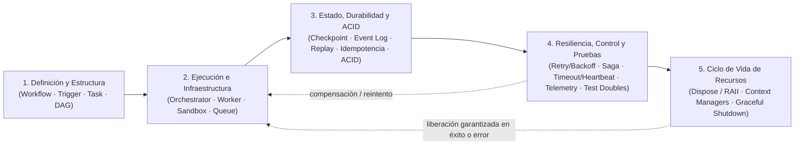
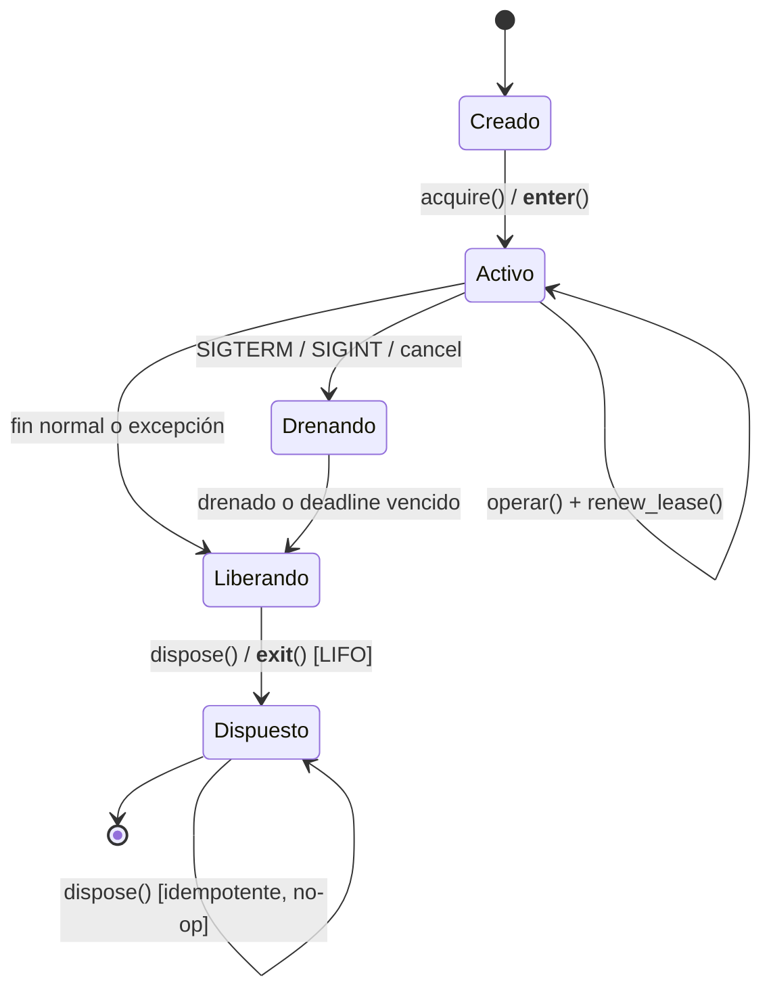

# Modo Agéntico de Orquestación — Ciclo de Vida Moderno de Ejecución Durable, ACID y `Dispose`

<!-- propiedad: CARLOS IVAN CM · revisión: manual -->

> **Propósito:** Marco teórico-práctico transversal y reutilizable para diseñar, auditar e implementar el **ciclo de vida moderno de ejecución, orquestación, transaccionalidad ACID, resiliencia y gestión determinista de recursos (`Dispose` / RAII)** en cualquier proyecto (CLI, API, worker, agente IA o sistema distribuido), registrando su trazabilidad en un vault gobernado sin romper la promesa de producto de VOA (**Markdown plano + JSON/JSONL + Git**, cero base de datos, cero embeddings y cero dependencias externas obligatorias).

---

## 1. Alcance y relación con el estándar

Este documento pertenece a la tríada de modos agénticos de `docs/`:

| Modo agéntico | Pregunta que responde | Documento | Skill asociada |
|---|---|---|---|
| **Sanación** | ¿Cómo adaptar un vault preexistente sin borrar nada? | [`MODO-AGENTICO-SANACION.md`](MODO-AGENTICO-SANACION.md) | `agent/skills/vault-sanacion/SKILL.md` |
| **Onboarding** | ¿Cómo poblar un vault desde un proyecto sin inventar? | [`MODO-AGENTICO-ONBOARDING.md`](MODO-AGENTICO-ONBOARDING.md) | `agent/skills/vault-onboard/SKILL.md` |
| **Orquestación** | ¿Cómo gobernar el ciclo de vida de ejecución, estado, ACID, resiliencia y `Dispose` en cualquier proyecto? | **`MODO-AGENTICO-ORQUESTACION.md`** | `agent/skills/vault-orquestacion/SKILL.md` |

Regla de frontera:
- **En cualquier proyecto consumidor:** este marco gobierna el diseño completo (definición, ejecución, estado, transacciones, resiliencia y ciclo de vida de recursos), adaptado a su perfil operativo (A, B o C).
- **Dentro de Vault-Obsidian-Architecture (VOA):** aplica **exclusivamente a los procesos internos de ejecución del toolkit** (lotes, rondas, pipelines de sincronización, aislamiento de subprocesos y cierre limpio), preservando intacto el almacenamiento documental en archivos planos y el catálogo oficial (`0` tools nuevas, `0` dependencias nuevas).

---

## 2. Los 5 Pilares del Ciclo de Vida Moderno de Ejecución

Todo sistema moderno de software, automatización o agentes de IA atraviesa cinco pilares acoplados. Omitir cualquiera produce sistemas frágiles (estados parciales corruptos, reintentos duplicados, procesos zombis o fugas de recursos).

### Pilar 1 — Definición y Estructura (Antes de ejecutar)

| Concepto | Definición operativa | Invariante obligatorio | Patrón en catálogo (`PAT-10`) |
|---|---|---|---|
| **Workflow / Pipeline** | Plano declarativo de alto nivel que agrupa pasos y transiciones en un orden lógico. | Todo flujo tiene entradas, precondiciones, postcondiciones y salidas verificables. | `dag-workflow-orchestration`, `pipe-and-filter` |
| **Trigger (Disparador)** | Evento, comando CLI, petición HTTP, webhook o programación (`cron`) que inicia una corrida (`run`). | Toda corrida nace con un `run_id` único y causa de disparo trazable. | `event-driven-architecture`, `command-dispatch-router` |
| **Task / Job** | Unidad acotada de trabajo asignable a un ejecutor o worker. | Responsabilidad única, contrato de entrada/salida explícito y límite de tiempo. | `command-dispatch-router`, `unit-of-work` |
| **DAG (Grafo Acíclico Dirigido)** | Grafo de dependencias entre tareas sin ciclos que determina orden topológico y paralelismo seguro. | Detección explícita de ciclos antes de ejecutar; nunca ordenamiento implícito por accidente. | `dag-workflow-orchestration` |

### Pilar 2 — Ejecución e Infraestructura (Cómo corre)

| Concepto | Definición operativa | Invariante obligatorio | Patrón en catálogo (`PAT-10`) |
|---|---|---|---|
| **Orchestrator / Engine** | Cerebro central que interpreta el DAG, decide el siguiente paso y despacha trabajo. | Separa la decisión de control (qué sigue) de la ejecución impura (I/O). | `dag-workflow-orchestration`, `wave-resource-scheduler` |
| **Worker / Runner** | Proceso o hilo que toma tareas de una cola o planificador y ejecuta el código real. | Sin estado oculto entre tareas; tolerante a reinicio abrupto. | `wave-resource-scheduler`, `object-pool` |
| **Sandbox / Container** | Entorno aislado (Job Object, subreaper, contenedor o proceso hijo acotado) que contiene el radio de impacto. | Un fallo o timeout del hijo nunca deja árboles huérfanos ni corrompe al anfitrión. | `process-isolation-sandbox` |
| **Queue / Broker** | Intermediario acotado entre productores y workers que absorbe picos y desacopla velocidades. | Cola acotada con política explícita de rechazo o contrapresión (*Backpressure*). | `backpressure`, `event-driven-architecture` |

### Pilar 3 — Estado, Durabilidad y Transaccionalidad ACID (Cómo recuerda y protege la integridad)

| Concepto | Definición operativa | Invariante obligatorio | Patrón en catálogo (`PAT-10`) |
|---|---|---|---|
| **State / Checkpoint** | Instantánea persistida del progreso de una corrida tras cada paso crítico. | Un reinicio continúa desde el último checkpoint válido, no desde cero. | `durable-execution-checkpoint-replay`, `memento` |
| **Event Sourcing / History Log** | Registro append-only inmutable de eventos o mutaciones ocurridas durante la corrida. | Solo anexado (`append-only`), orden causal verificable y trazable. | `event-sourcing`, `append-only-event-log` |
| **Deterministic Execution** | La lógica de orquestación produce exactamente la misma secuencia de decisiones ante el mismo historial. | Relojes, aleatoriedad e I/O viven encapsulados en actividades/puertos, nunca sueltos en el coordinador. | `durable-execution-checkpoint-replay`, `hexagonal-ports-adapters` |
| **Replay** | Reconstrucción del estado en memoria leyendo el historial de eventos o checkpoints tras un fallo. | El replay nunca vuelve a disparar efectos secundarios ya completados. | `durable-execution-checkpoint-replay` |
| **Idempotency (Idempotencia)** | Ejecutar la misma operación $N$ veces con la misma clave produce el mismo efecto observable que ejecutarla una vez. | Toda escritura reintentable lleva clave de idempotencia o verificación de estado previo. | `idempotent-consumer`, `atomic-write` |
| **Transacciones ACID** | **A**tomicidad (todo o nada), **C**onsistencia (invariantes preservados), **A**islamiento (sin lecturas sucias/carreras) y **D**urabilidad (persistencia firme). | En BD: transacciones reales + Outbox. En archivos planos (VOA): `write-temp` + `fsync` + `os.replace` + lock de proceso + pre-SHA Git. | `acid-transactions`, `atomic-write`, `transactional-outbox`, `unit-of-work` |

### Pilar 4 — Resiliencia, Control y Pruebas (Cómo sobrevive a fallos)

| Concepto | Definición operativa | Invariante obligatorio | Patrón en catálogo (`PAT-10`) |
|---|---|---|---|
| **Retry Policy / Backoff** | Reintentos acotados con espera exponencial + *jitter* solo ante fallos transitorios. | Nunca reintentar errores permanentes de validación; respetar tope máximo y presupuesto de tiempo. | `circuit-breaker-retry`, `rate-limiter-throttling` |
| **Compensation / Saga** | Secuencia de acciones compensatorias explícitas para deshacer pasos ya confirmados si un paso posterior falla. | Todo paso con efecto externo o mutación en lote declara su compensación o punto de restauración. | `saga-compensation`, `snapshot-quarantine-rollback` |
| **Timeout / Heartbeat & Lease** | Tiempo máximo por paso/corrida y concesiones renovadas periódicamente para detectar workers colgados. | Ninguna espera ni bloqueo es infinito; un lease expirado se libera de forma segura. | `timeout-deadline-propagation`, `heartbeat-lease` |
| **Test Doubles (`Stub`, `Mock`, `Spy`, `Fixture`)** | Dobles de prueba disciplinados para aislar fronteras de I/O, reloj y red sin falsear invariantes. | Verificar con el criterio del consumidor real (`AP-44`); probar siempre fallos, timeouts y re-ejecución. | `hexagonal-ports-adapters` |
| **Telemetry / Trace** | Trazas estructuradas, correlación (`run_id` / `step_id`), métricas de latencia y tasa de error. | Cero fallos silenciados (`AP-51`); todo error se emite bajo contrato canónico (`AP-52`). | `envelope-result-object`, `append-only-event-log` |

### Pilar 5 — Ciclo de Vida de Recursos y Patrón `Dispose` / RAII (Cómo nace, vive y muere cada recurso)

Este pilar suele ser el más descuidado en toolkits, scripts y servicios de larga duración. Un recurso adquirido sin dueño explícito de liberación produce fugas de descriptores de archivo, locks huérfanos, temporizadores colgados, sockets abiertos y subprocesos zombis.

#### Reglas no negociables del patrón `Dispose` / RAII

1. **Adquisición acoplada a liberación (RAII):** todo recurso escaso (archivo abierto, lock, conexión, cliente HTTP, timer, subproceso, directorio temporal) se adquiere dentro de un gestor de ámbito (`with` / `async with` / `ExitStack` en Python; `using` / `Symbol.dispose` en TS/C#; `defer` en Go; `Drop` en Rust).
2. **Idempotencia de `dispose()`:** llamar `dispose()` / `close()` dos o más veces es seguro y sin efecto tras la primera liberación.
3. **Orden LIFO (inverso a la adquisición):** si se adquiere `lock -> temp_file -> subprocess`, la liberación ocurre estrictamente `subprocess -> temp_file -> lock`, incluso si un paso intermedio lanza excepción.
4. **Cierre sin enmascarar la excepción original:** un error secundario durante `dispose()` se registra en telemetría o se agrupa, pero nunca borra la causa raíz del fallo principal (`AP-51`).
5. **Graceful Shutdown & Draining:** todo proceso de larga duración (servidor MCP, API, worker, lote largo) intercepta `SIGTERM`/`SIGINT`, deja de admitir trabajo nuevo, drena operaciones en curso hasta un *deadline* acotado y ejecuta `dispose()` en cascada antes de terminar.
6. **Cero fugas verificadas en pruebas:** la suite valida que tras éxito, excepción y cancelación no queden archivos temporales, locks activos ni subprocesos vivos.

---

## 3. Tres Perfiles de Aplicación (Según el Proyecto)

No todos los proyectos necesitan un broker distribuido ni un motor como Temporal. Elegir el perfil correcto evita tanto la sobreingeniería como la fragilidad:

| Dimensión | Perfil A — Ligero / CLI / Toolkit (ej. VOA) | Perfil B — Servicio / API / Worker | Perfil C — Distribuido / Orquestación Durable |
|---|---|---|---|
| **Definición (P1)** | Pipeline en código + DAG en stdlib (`graphlib.TopologicalSorter`) | Jobs declarativos + triggers HTTP/cron + DAG | Motor de workflows durable (Temporal, Inngest, Airflow, Step Functions) |
| **Ejecución (P2)** | Proceso local + aislamiento de subprocesos (Job Object / `start_new_session`) | Pool de workers + contenedores + colas acotadas | Clúster de workers distribuidos + brokers (Kafka/RabbitMQ/Redis) |
| **Estado y ACID (P3)** | `write-temp` + `os.replace` + lock de archivo + JSONL append-only + Git pre-SHA | Transacciones ACID en BD + Transactional Outbox + claves de idempotencia | Event Sourcing + Checkpoints persistidos + Replay determinista + ACID por agregado |
| **Resiliencia (P4)** | Pre-SHA rollback / Saga local + timeouts + pruebas deterministas | Retry con backoff + jitter + Circuit Breaker + DLQ + trazas OpenTelemetry | Sagas orquestadas + Heartbeat/Lease distribuido + chaos/replay testing |
| **Recursos / `Dispose` (P5)** | `with` / `ExitStack` + limpieza garantizada de locks, temps y subprocesos | `IDisposable`/`AsyncExitStack` + pools acotados + `SIGTERM` draining | Leases con TTL + draining coordinado + `preStop` hooks + cierre determinista |

---

## 4. Plan de Implementación Agéntica en 5 Fases

Cuando apliques este marco a cualquier proyecto (nuevo o heredado), ejecuta estas cinco fases en orden:

1. **Fase 1 — Diagnóstico y Perfilado:**
   - Recuperar contexto existente del vault (`vault_context_pack`).
   - Escanear patrones actuales del repositorio (`vault_pattern_list --scan-path <repo>`).
   - Clasificar el proyecto en **Perfil A, B o C** y levantar inventario de flujos críticos, recursos abiertos y puntos de fallo sin protección.
2. **Fase 2 — Fronteras, DAG y Contratos:**
   - Separar lógica determinista de orquestación respecto a adaptadores de I/O (Puertos y Adaptadores).
   - Modelar dependencias de pasos como DAG explícito (eliminando ordenamientos implícitos) y documentar cada flujo (`vault_flow_save`).
3. **Fase 3 — Integridad ACID, Durabilidad y `Dispose` / RAII:**
   - Cerrar todo punto de mutación parcial con transacciones ACID (o `write-temp` + `os.replace` + lock + Git en Perfil A).
   - Introducir checkpoints/claves de idempotencia donde exista reintento o corrida larga.
   - Auditar cada adquisición de recurso (archivos, locks, conexiones, timers, subprocesos) e imponer `Dispose` / RAII + `Graceful Shutdown`.
4. **Fase 4 — Resiliencia, Sagas y Pruebas de Fallo:**
   - Definir políticas explícitas de `timeout`, `retry` con backoff acotado, `heartbeat/lease` y acciones compensatorias (`Saga`) para operaciones compuestas.
   - Escribir pruebas de fallo inyectado, doble ejecución (idempotencia), cancelación y verificación de cero fugas (`vault_test_save`).
5. **Fase 5 — Observabilidad, Revisión y Registro en Vault:**
   - Asegurar telemetría estructurada y runbooks de recuperación (`vault_runbook_save`, `vault_infra_save`).
   - Persistir requisitos (`vault_requirement_save`), patrones detectados (`vault_pattern_save`) y ejecutar `vault_code_review` + `vault_audit`.

---

## 5. Hoja de Ruta Etapa 2 para los Procesos Internos de VOA (Orden Seguro)

Dentro de **Vault-Obsidian-Architecture**, el almacenamiento sigue siendo 100% Markdown plano + JSON/JSONL + Git (`0` BD, `0` embeddings, `0` terceros, `0` tools nuevas). La adopción interna en Etapa 2 aplica **Perfil A** en cuatro incrementos priorizados de menor a mayor superficie de cambio:

| Prioridad | Incremento | Qué protege | Mecanismo sin dependencias externas |
|---|---|---|---|
| **P1** | **Saga / Compensación por pre-SHA Git en lotes** | Escrituras compuestas (`vault_propagate --curate-apply`, lotes multi-nota) | Capturar `HEAD` pre-lote; ante fallo parcial, restaurar/compensar determinísticamente y registrar evento en `.change-log.jsonl`. |
| **P2** | **Checkpoints y Replay JSONL en rondas y lotes largos** | `vault_ronda`, `vault_onboard`, `vault_sanacion` | Persistir checkpoints idempotentes en JSONL dentro de `00_System/` para reanudar sin duplicar notas ni trabajo ya validado. |
| **P3** | **DAG topológico en `vault_fix_all`** | Los 12 pasos derivados de `scripts/vault_fix_all.py` | Declarar dependencias explícitas con `graphlib.TopologicalSorter` (stdlib) en vez de lista lineal rígida, detectando ciclos y permitiendo ejecución por capas. |
| **P4** | **Heartbeat / Lease + `Dispose` / `Graceful Shutdown` estricto** | Locks de `vault_lock`, subprocesos en `aislamiento.py` y servidor MCP Node (`SIGTERM`/`SIGINT`) | Leases con renovación acotada, `ExitStack` en operaciones compuestas y drenaje ordenado del coordinador CQRS en `vault-mcp-server.mjs`. |

---

## 6. Referencias Cruzadas

- **Catálogo oficial de patrones (`PAT-10`):** `vault/kernel/patrones_diseno.py` (72 patrones en 5 categorías, incluyendo `dispose-raii`, `acid-transactions`, `saga-compensation`, `durable-execution-checkpoint-replay`, `dag-workflow-orchestration`, `heartbeat-lease` y `graceful-shutdown`).
- **Skill agéntica invocable:** [`agent/skills/vault-orquestacion/SKILL.md`](../agent/skills/vault-orquestacion/SKILL.md).
- **Mapa por capas de VOA:** [`docs/architecture/MAPA-CAPAS.md`](architecture/MAPA-CAPAS.md).
- **Contratos y carriles de cierre:** [`docs/CARRILES.md`](CARRILES.md) · [`docs/PUERTAS.md`](PUERTAS.md).
