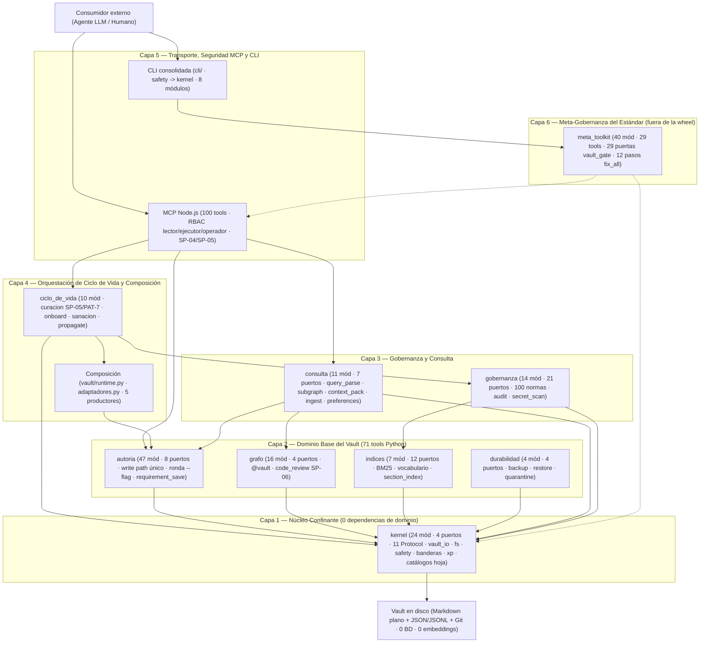

# Mapa de Arquitectura por Capas, Inventario y Control de Flujo

> **Propósito:** mapa operativo y de control de flujo para humanos y agentes externos. Permite entender en menos de 2 minutos la esencia de **Vault-Obsidian-Architecture**, qué pertenece a cada capa (Capas 1–6), cómo fluyen los datos y la seguridad, y exactamente dónde tocar (y qué no tocar) ante cualquier cambio.
>
> **Fuentes canónicas vivas (en caso de discrepancia, mandan los registros):** [docs/BLUEPRINT.md](../BLUEPRINT.md) · [docs/ARQUITECTURA.md](../ARQUITECTURA.md) · [docs/GOBIERNO.md](../GOBIERNO.md) · [docs/CARRILES.md](../CARRILES.md) · [docs/ENTORNO.md](../ENTORNO.md)
>
> **Vistas visuales interactivas (Archify):** [mapa-capas.html](../../.archify/mapa-capas.html) · [mapa-contextos.html](../../.archify/mapa-contextos.html) · [mapa-cruces.html](../../.archify/mapa-cruces.html) · [mapa-onboarding.html](../../.archify/mapa-onboarding.html)
>
> **Índices de contexto para agentes:** [AGENTS.md](../../AGENTS.md) · [CLAUDE.md](../../CLAUDE.md) · [Índice de skills](../../agent/skills/)

---

## 1. La esencia del repositorio (invariante de producto)

1. **Este repositorio es el estándar (especificación + toolkit), no un vault.** Toda ejecución de pruebas corre contra `vault-sandbox/`.
2. **Un solo servicio:** dar a un agente LLM memoria documental persistente, auditable y gobernada sobre **Markdown plano + JSON/JSONL + Git**, sin base de datos, sin embeddings y sin servicios externos.
3. **Tres capacidades:** `escritura → gobernanza` (91 tools), `consulta → contexto` (10 tools) y `gobernanza del estándar` (29 tools, fuera de la wheel).
4. **Cero inflación de superficie (Opción A):** las capacidades nuevas (`SPEC-01..04`, Fases H/Q/R) se integran como endurecimiento y subcomandos sobre el catálogo vigente de **130 tools / 37 grupos (100 expuestas en MCP)**.

---

## 2. Vista visual por capas (Capas 1–6)

---

## 3. Inventario técnico y control por capa

| Capa | Propósito | Contextos y módulos clave | Superficie (Tools / Puertos) | Módulos Fases H / Q / R | Regla de dependencia | Puertas de control |
|---|---|---|---|---|---|---|
| **Capa 1 — Núcleo** | Mecanismos atómicos, seguridad base, políticas O(1) y catálogos hoja | `kernel` (24 mód. en `CONTEXTS`, 61 `.py` en `vault/kernel/`) | 0 tools directas · 4 puertos + 11 `Protocol` | `vault/kernel/safety.py`, `vault/kernel/banderas.py`, `vault/kernel/normativa/xp.py` | **No importa ningún contexto de dominio** | `vault_arch`, `vault_kernel`, `vault_ciclos`, `vault_procesos_git` |
| **Capa 2 — Dominio Base** | Escritura gobernada, grafo de código, índices BM25 y durabilidad | `autoria` (47), `grafo` (16), `indices` (7), `durabilidad` (4) | 71 tools Python · 28 puertos | `vault_ronda` (`--flag`, bloqueo `ejecutor`), `vault_requirement_save` (`--buffer`, gate TDD), `vault_code_review` (`ADR_INVARIANT_TOUCHED`, `SP-06`), `vault_infra_save` (`data_source`) | Solo cruza por puertos declarados (`off_port = 0`) | `vault_arch`, `vault_criterios`, `vault_fuente_unica`, `vault_error_contract` |
| **Capa 3 — Gobernanza y Consulta** | Auditoría normativa y ensamblado de contexto sin BD ni embeddings | `gobernanza` (14), `consulta` (11) | 20 tools · 28 puertos | `vault_context_pack` (`--max-sensitivity`, `PAT-7`, `scan_poison`), `vault_ingest` (`SSRF`, `conflict_candidates`, `fanout_plan`), `vault_preferences` (`--adapters` + `SP-06`) | Lee Capas 1–2; `consulta` prohíbe BD/embeddings/red por defecto | `vault_norms`, `vault_norms_coherence`, `vault_audit`, `vault_quality_check` |
| **Capa 4 — Ciclo de Vida y Composición** | Orquestación batch, sanación, onboarding y cableado runtime | `ciclo_de_vida` (10) + `vault/runtime.py` + `vault/kernel/adaptadores.py` | 10 tools · 3 puertos + 5 productores | `vault/ciclo_de_vida/curacion.py` (`--curate-plan`, `--curate-apply`, `--mark-contradicts` vía `BitacoraCambios`) | Cablea Capas 1–3 usando puertos del kernel (0 cruces nuevos) | `vault_arch`, `vault_error_contract`, `vault_blueprint` |
| **Capa 5 — Transporte, RBAC y CLI** | Exposición MCP/CLI, autenticación HTTP/stdio y 2 tools JS nativas | `cli` (8) + `mcp/nodejs/vault-mcp-server.mjs` + `vault_toolkit/` | 2 tools JS nativas · 100 MCP expuestas · RBAC `lector`/`ejecutor`/`operador` | `VAULT_MCP_ROL` fail-closed, protección `vault_registry`, bloqueo `ejecutor` en `vault_ronda --abrir/--cerrar`, paridad `secret_scan` | Traduce transporte; **no inventa política de dominio** (`AP-48`, `AP-57`) | `vault_mcp_catalog --check/--check-contracts`, `vault_blame_audit`, `vault_arch --sync-env` |
| **Capa 6 — Meta-Gobernanza** | Verificación del estándar, puertas, baselines y docs derivados | `meta_toolkit` (40) + `.archify/` + `audits/` | 27 tools en `meta_toolkit` (29 en Grupo 35) · 8 puertos | `vault_fix_all` (12 pasos incl. `vault_servicio --doc`), `SP-05`/`SP-06` en catálogo (100 normas) | **Excluida de la wheel**; jamás escribe notas de un vault real | `vault_gate --strict` (29 puertas), `vault_servicio`, `vault_doc_counts`, `vault_doc_sync` |

---

## 4. Control de flujo para cambios (guía rápida para humanos y agentes)

Antes de modificar cualquier fichero, ubica tu cambio en esta matriz para preservar la esencia del repositorio:

| Si necesitas cambiar… | Capa y dueño exacto | Qué NO debes hacer | Verificación mínima obligatoria |
|---|---|---|---|
| Una regla pura, catálogo o validación compartida | **Capa 1** (`vault/kernel/` o `vault/kernel/normativa/`) | Importar `vault.autoria`, `vault.gobernanza` o `scripts/` | `vault_arch --check --strict` + `vault_ciclos --check --strict` |
| Una norma `AP`/`PAT`/`SP`/`CN` | **Capa 1 + 3 + 6** (`normas/<COD>/` + `norms_catalog.py` + manifiesto) | Editar `guard.py`/`heal.py` a mano ni usar `enforcement: manual` | `vault_fix_all.py` + `vault_norms --check-framework` + `vault_norms_coherence --check --strict` |
| Escritura, validación o metadatos de notas | **Capa 2** (`vault/autoria/` + `scripts/vault_*.py`) | Montar frontmatter con `"---"` a mano (`AP-57`) ni saltarse `scan_poison` | `vault_criterios --check --strict` + `vault_error_contract --check --strict` |
| Recuperación de contexto o ingesta | **Capa 3** (`vault/consulta/` + `scripts/vault_context_pack.py`/`vault_ingest.py`) | Introducir BD, embeddings o llamadas de red sin `--allow-network` | `pytest tests/test_karpathy_ingest.py tests/test_hardening_fase_h.py` |
| Curación batch, propagación o sanación | **Capa 4** (`vault/ciclo_de_vida/` + `scripts/vault_propagate.py`) | Importar `vault_append`/`vault_change_log` directo (usar puerto `BitacoraCambios`) | `vault_arch --check --strict` + `pytest tests/test_fabrica_conocimiento_fase_q.py` |
| Seguridad MCP, RBAC o variables de entorno | **Capa 1 + 5** (`vault/kernel/entorno.py` + `mcp/nodejs/vault-mcp-server.mjs`) | Leer `process.env` sin declararlo en `entorno.py` + `--sync-env` | `node --check mcp/nodejs/vault-mcp-server.mjs` + `vault_entorno --check-doc` + `vault_blame_audit` |
| Un documento derivado (`BLUEPRINT`, `ARQUITECTURA`, `GOBIERNO`, `ENTORNO`, `tools-catalog.json`) | **Capa 6** (ejecutar `python scripts/vault_fix_all.py`) | Editar manualmente bloques derivados o cifras | `vault_gate.py --strict --nivel rapida` |

---

## 5. Flujos cerrados críticos (verificados en Fases H, Q y R)

1. **Write Path blindado:** `Cliente → MCP/CLI → guardSecretScan → scan_poison (no desactivable) → motivo_proteccion_nota (AP-73/75) → Frontmatter canónico (AP-46) → atomic_write_text (AP-36) → .change-log.jsonl → Git`.
2. **Fábrica de Conocimiento (`SP-05`):** `Ejecutor (VAULT_MCP_ROL=ejecutor) → vault_ronda --flag → scan_poison → 00_System/.flags.jsonl` *(bloqueado en `--abrir`/`--cerrar`/`vault_write`)* → `Operador → vault_propagate --curate-plan / --curate-apply → puerto BitacoraCambios → source_flags + 19_Audits/curation/ + acción curated`.
3. **Disciplina XP progresiva (`SP-06`, opt-in):** `00_System/reglas.json (xp_level: 1..4) → validar_politica_xp O(1) fail-closed → Nivel 1 (--buffer) → Nivel 2 (gate TDD en 15_Tests/ + NO_TESTS_TOUCHED blocker) → Nivel 3 (XP_MONOLITHIC_DIFF + --reviewer humano AP-64) → Nivel 4 (exige xp_prerequisites verificados)`.
4. **Consulta sin BD ni embeddings:** `vault_query_parse → vault_subgraph → vault_context_pack` (con filtro `--max-sensitivity`, advertencia bilateral `PAT-7 contradicts:` y defensa `scan_poison`).

---

## 6. Navegación cruzada (red de referencias)

- **Reglas operativas para agentes:** [AGENTS.md](../../AGENTS.md) · [CLAUDE.md](../../CLAUDE.md)
- **Planos derivados automáticos:** [docs/BLUEPRINT.md](../BLUEPRINT.md) · [docs/ARQUITECTURA.md](../ARQUITECTURA.md) · [docs/GOBIERNO.md](../GOBIERNO.md)
- **Vista conceptual complementaria:** [docs/architecture/layers.md](layers.md) · [docs/architecture/CONSTITUCION-ARQUITECTONICA.md](CONSTITUCION-ARQUITECTONICA.md)
- **Modos agénticos:** [docs/MODO-AGENTICO-SANACION.md](../MODO-AGENTICO-SANACION.md) · [docs/MODO-AGENTICO-ONBOARDING.md](../MODO-AGENTICO-ONBOARDING.md)
- **Decisiones de arquitectura:** [docs/adr/](../adr/) · **Normas empaquetadas:** [normas/](../../normas/)
